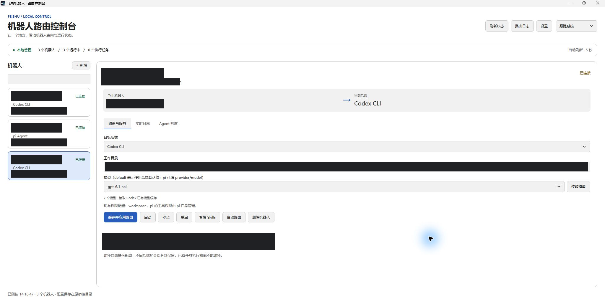

# 飞书机器人路由控制台

Windows 上的 C# / WPF 飞书机器人路由控制台，当前 v0.3.0，统一管理 Codex、Antigravity 和 pi Agent。下载运行包请前往 [GitHub Releases](https://github.com/AIXHB/FeishuRouteManager/releases)，本版变更见 [发布说明](RELEASE-NOTES.md)。

## 界面预览

实际工具界面截图；机器人名称、App ID、本机工作目录及运行标识已遮盖。

## 在线查看源码

完整源码已直接上传到本仓库的 `main` 分支，无需下载或解压。Release 页面中的 ZIP 是下载附件，查看代码请使用以下入口：

- [全部源码目录](https://github.com/AIXHB/FeishuRouteManager/tree/main)
- [桌面界面与服务协调（C# / WPF）](RouterManager.App/)，例如 [主窗口代码](RouterManager.App/MainWindow.xaml.cs)
- [机器人发现、状态与日志（C#）](RouterManager.Core/)
- [两套飞书桥接源码及补丁](integrations/)
- [测试代码](RouterManager.Tests/)

也可使用 `git clone https://github.com/AIXHB/FeishuRouteManager.git` 获取完整工程。

开发及 AI 接手从 [AGENTS.md](AGENTS.md) 开始；[开发指南](docs/ref/development-guide.md)、[产品设计](docs/designs/product-design.md)、[架构设计](docs/designs/architecture-design.md)、[部署与迁移](docs/ref/deployment-reference.md) 提供详细说明。文档中的本机绝对路径仅用于维护记录，新机器需配置自己的集成路径。

源码包从工程根执行 `setup-dependencies.ps1` → `build.ps1` → `test.ps1`；`package.ps1` 生成源码和 Windows 两份 ZIP。工程包不包含用户凭据或运行会话。Windows 运行包可直接双击 `app/FeishuRouterManager.exe`，用 `install-start-menu.ps1` 安装开始菜单入口。

C# / WPF 本地桌面应用，运行于 Windows 和 .NET 8 Desktop Runtime。本机已安装所需运行环境。

## 当前功能

- 多机器人独立路由、模型和工作目录，切换失败自动恢复；支持新增、删除和服务管理。
- 每台机器人单独安装及卸载 skill，保持副本和运行目录隔离。
- 飞书 `/help`、`/model`、`/models`、`/cancel`、`/pwd`；Lark 支持 `/sessions [N]`。
- 可选的 Codex 额度耗尽自动切换 pi，以及额度预计恢复提醒；默认关闭。
- 深浅主题、路由日志、只读额度查询，以及心跳写入失败重试。

首次使用还需 Node.js 22.19+、对应 Agent CLI 和登录、飞书应用及桥接配置。运行包不携带桥接依赖、用户凭据或会话，桥接源码快照在源码包的 `integrations/`，需要按部署指南安装依赖并显式部署。

## v0.3 更新（2026-10-21）

- 机器人列表右上角“＋ 新增”：填写名称、App ID、App Secret，选择 Codex / Antigravity / pi、已有模型、工作目录和权限。可分别选择登录自启、保存后立即启动；两者默认关闭。
- 保存前校验必填项、工作目录和重复 App ID；随后通过桥接验证飞书凭据并加密保存。凭据验证需要联网，列表模型可以沿用本地目录。
- 新增时先在独立目录构建配置，再将新 profile 和加密凭据合并到主配置；保留其他机器人的配置和未知字段。保存后未勾选立即启动时，可点击“启动”上线。
- “路由与服务”增加“删除机器人”：确认后停止该机器人，移除对应计划任务及活动配置；保留工作目录、会话、日志与加密凭据。执行任务期间禁止删除。
- 删除备份保存在 `%LOCALAPPDATA%/FeishuRouterManager/archives/<App ID>-<时间戳>`，包含配置和计划任务定义；删除失败会尝试恢复配置和任务状态。原生 pi 的活动配置也会归档，避免删除后被重新发现。
- 新增与删除均记录路由日志。开始菜单入口继续使用原位置；程序保留定制图标。

## v0.2 更新（2026-10-21）

- 参考 Cursor 的中性黑、白配色，增加深色、浅色和跟随 Windows 系统三种主题；选择会保存，跟随系统时在自动刷新中响应系统主题变化。
- 重新实现目标后端与模型下拉框的配色，避免选中值和弹出列表出现文字与底色接近的问题。
- 模型由 Agent 实际目录读取：Codex 读取本地缓存，并可点击“读取模型”调用 `model/list` 刷新；Antigravity 调用 `agy models`；pi 读取配置和本地模型目录。列表支持搜索和手动输入模型 ID。
- 顶部“路由日志”打开独立日志窗口，可在“机器人 → Agent”和“Agent → 机器人”之间切换，并按机器人、Agent、级别、时间范围和关键词筛选。控制台的应用路由、启停、失败与额度查询会写入独立审计日志；已有 Agent 运行日志也会统一读取。缺失历史 Agent 信息时标注“未记录”，不使用当前路由猜测。
- “Agent 额度”页支持手动查询；设置中增加定时查询总开关、5–1440 分钟间隔及 Agent 分类开关。总开关默认关闭，仅在控制台打开时执行，关闭窗口即停止。
- Codex 通过官方只读 `account/rateLimits/read` 接口查询，同一个账号的机器人合并查询。Antigravity CLI 与 pi 暂无统一额度接口，明确显示“不支持”；查询失败或接口未返回数据时显示“不可用”，不会伪造零额度。
- 修复现有 Lark Bridge 对新模型 ID 的静态列表过滤，以及 Antigravity 没有转发模型参数的问题。该桥接修复在下次应用路由或机器人重启后加载，不强制打断现有机器人。

## 启动

双击 `app/FeishuRouterManager.exe`。请保留整个 `app` 文件夹中的 DLL、JSON 和 Assets 文件。

启动时只读取现有配置，不会自动接管、重启或改变任何机器人。应用已在本机识别路飞、当当、娟娟及其现有自启任务。

## 使用

1. 左侧选择机器人，可搜索名称、App ID 或后端。
2. 在“路由与服务”选择 Codex CLI、Antigravity CLI 或 pi Agent，设置工作目录和模型。
3. 点击“保存并应用路由”，核对弹窗中的目标后再应用。
4. 使用启动、停止、重启按钮控制所选机器人，在“实时日志”查看最近事件。

状态每 5 秒刷新。执行中的任务会阻止路由切换；主动停止服务会中断当前任务。重启和切换通常需要约一分钟，窗口会等待操作或恢复流程完成。

模型填 `default` 使用后端默认值；pi 也可填写 `provider/model`，例如 `deepseek/deepseek-v4-flash`。切换后端时模型输入会重置，避免把 pi 的模型名误传给 Codex。

## 与现有部署的关系

- 自动发现 `.lark-channel` 的 profile、运行注册表、日志和 Windows 计划任务；原 pi 服务从任务和工作目录识别。
- “集成设置”可以调整 Lark 配置目录、桥接入口、pi 安装目录和 Node.js 路径。
- 第一次应用路由会备份配置、停用原自启任务，改用独立的 `FeishuRouterManager.<App ID>` 任务，避免两个连接抢占同一机器人。
- 关闭管理窗口不会停止机器人。后台服务由计划任务管理，并在失败后重试。
- 同一机器人不同后端的历史保留在各自目录，不会把 Antigravity 的会话 ID 交给 Codex。
- pi 运行包、会话映射、文件缓存和 Agent 配置按机器人隔离；共享已有安装的依赖。原 pi 安装内容不会被改写。
- 凭据在后台读取，界面和日志隐藏凭据。Lark 的加密密钥库继续使用；切换到 pi 时，通过进程环境传递凭据，不把 App Secret 写入新增 pi 配置文件。
- 跨 Lark → pi 会保留原机器人所有者、用户/群允许名单和 @ 策略。pi 自身的工具执行权限与 Codex 沙箱不同，切换弹窗会说明这一点。

## 备份与恢复

管理器数据存放在 `%LOCALAPPDATA%/FeishuRouterManager`；每个机器人的 `bots/<App ID>/backups/<时间戳>` 保存应用前配置。新服务未能上线时，程序恢复该机器人的旧 profile、路由记录及原自启任务；其他机器人的配置不随回滚覆盖。

本版本的“上线验证”检查进程、桥接注册信息或 pi 连接心跳，不会自动向他人发送测试消息。切换后可在飞书发送“你好”验证真实收发。模型授权、账号额度和模型名称错误仍可能在实际调用时出现，可从日志查看。

## 开发与验证

- `RouterManager.App`：WPF 界面及服务协调。
- `RouterManager.Core`：机器人发现、运行状态、日志读取与脱敏。
- `RouterManager.App/Assets/manager.mjs`：配置锁、独立后台服务、跨桥接切换与失败恢复。
- `RouterManager.Tests`：无额外测试依赖的 C# 检查和 Node 测试。

运行 `build.ps1` 构建并发布到 `app`；运行 `test.ps1` 执行测试。Node 路由测试默认使用 `integrations/lark-channel-bridge`，也可通过 `FEISHU_TEST_BRIDGE_ENTRY` 指向其他已安装依赖的桥接入口，用它的 proper-lockfile 依赖，但只改动临时测试配置。

已验证：C# 编译、只读本机发现、日志脱敏、过期注册表识别、配置字段保留、并发写锁、失败回滚、两个模拟 pi 实例隔离。开发验证没有切换现有三个机器人的路由。
