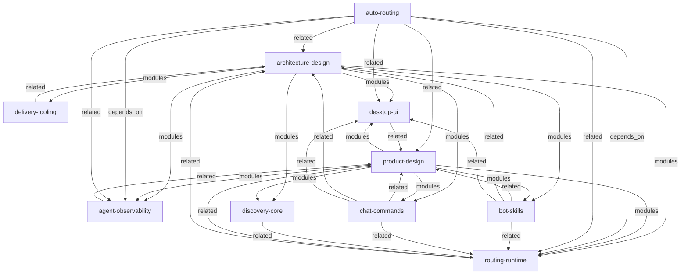

# 项目文档地图

> 由 `docctl map` 自动生成，请勿手工维护。

## 设计

| ID | 类型 | 摘要 | 模块 | 状态 |
|---|---|---|---|---|
| [[architecture-design]] | technical | 桌面控制面与后台服务的数据边界及事务设计 | [desktop-ui, routing-runtime, discovery-core, agent-observability, delivery-tooling, chat-commands, bot-skills] | active |
| [[product-design]] | product | 机器人级路由控制台产品范围、流程和可观察验收 | [desktop-ui, routing-runtime, discovery-core, agent-observability, chat-commands, bot-skills] | active |

## 模块

| ID | 摘要 | key_files | depends_on | 状态 |
|---|---|---|---|---|
| [[agent-observability]] | Agent 模型/额度读取、查询计划、结构日志与审计 | [RouterManager.App/AgentServices.cs, RouterManager.App/Assets/agent-data.mjs, RouterManager.Core/Preferences.cs, RouterManager.Core/RouteLogs.cs, RouterManager.App/LogWindow.cs] | [] | active |
| [[auto-routing]] | 机器人级 Codex 额度耗尽后切 pi、持久时间和飞书恢复提醒 | [RouterManager.App/AutoRouting.cs, RouterManager.App/AutoRouteWindow.cs, RouterManager.App/Assets/auto-route.mjs, RouterManager.App/Assets/manager.mjs, integrations/lark-channel-bridge/src/runtime/run-executor.ts] | [routing-runtime, agent-observability] | active |
| [[bot-skills]] | 按 App ID 隔离的专属 skill 安装、卸载、预览和每次任务加载 | [RouterManager.Core/BotSkills.cs, RouterManager.App/SkillManagement.cs, RouterManager.App/SkillManagerWindow.cs, integrations/lark-channel-bridge/src/agent/bot-skills.ts, integrations/pi-feishu/patched-package/dist/skills/bot-skills.js, integrations/pi-feishu/patched-package/dist/bridge/runtime-host.js] | [] | active |
| [[chat-commands]] | 飞书聊天命令、远程模型选择与桥接补丁边界 | [integrations/lark-channel-bridge/src/commands/index.ts, integrations/lark-channel-bridge/src/config/config-ops.ts, integrations/lark-channel-bridge/src/card/templates.ts, integrations/pi-feishu/patched-package/dist/bridge/message-handler.js, integrations/pi-feishu/patched-package/dist/bridge/message-normalizer.js] | [] | active |
| [[delivery-tooling]] | 构建、依赖快照、打包与 AI 文档入口 | [build.ps1, test.ps1, setup-dependencies.ps1, package.ps1, install-start-menu.ps1, integrations/README.md] | [] | active |
| [[desktop-ui]] | WPF 交互、主题、图标与编辑状态 | [RouterManager.App/MainWindow.xaml, RouterManager.App/MainWindow.xaml.cs, RouterManager.App/NewBotWindow.cs, RouterManager.App/Themes.xaml, RouterManager.App/ThemeManager.cs] | [] | active |
| [[discovery-core]] | 机器人发现、任务/真实 PID 与运行状态核对 | [RouterManager.Core/BotDiscovery.cs, RouterManager.Core/IntegrationPaths.cs, RouterManager.Core/Models.cs, RouterManager.App/RouterBackend.cs] | [] | active |
| [[routing-runtime]] | 路由、新增删除事务及后台服务隔离 | [RouterManager.App/RouterBackend.cs, RouterManager.App/BotLifecycle.cs, RouterManager.App/Assets/manager.mjs, RouterManager.App/Assets/lifecycle.mjs] | [] | active |

## 关系图

